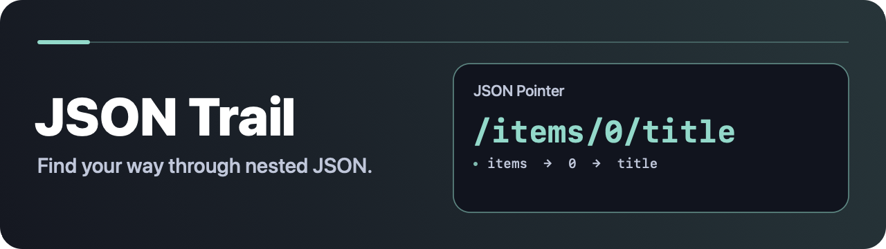
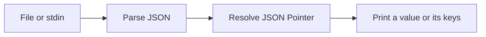

<p align="center">
  
</p>

# JSON Trail

Pick a nested value out of a JSON file or inspect the available keys without opening an editor.

## At a glance

| Task | How |
| --- | --- |
| **Read a nested value** | Pass a JSON Pointer such as `/items/0/title`. |
| **Explore a container** | Use `--keys` to see what you can select next. |
| **Use it in a pipeline** | Pass `-` to read stdin and `--compact` for compact JSON. |

## Quick start

```sh
python3 json_trail.py catalog.json /items/0/title
python3 json_trail.py catalog.json /items/0 --keys
cat catalog.json | python3 json_trail.py - /items --compact
```

Requires Python 3.8+. An empty pointer returns the whole document. Array indices start at zero. Use `~1` for a slash and `~0` for a literal tilde inside a key. [MIT](LICENSE)

## Try it with sample input

```sh
printf '%s\n' '{"items":[{"title":"Sound check"}]}' | python3 json_trail.py - /items/0/title
```

This prints the JSON string `"Sound check"`. Errors go to stderr and produce exit status 2.



## Development

Run the dependency-free test suite from the repository root.

```sh
python3 -m unittest discover -s tests -v
```
